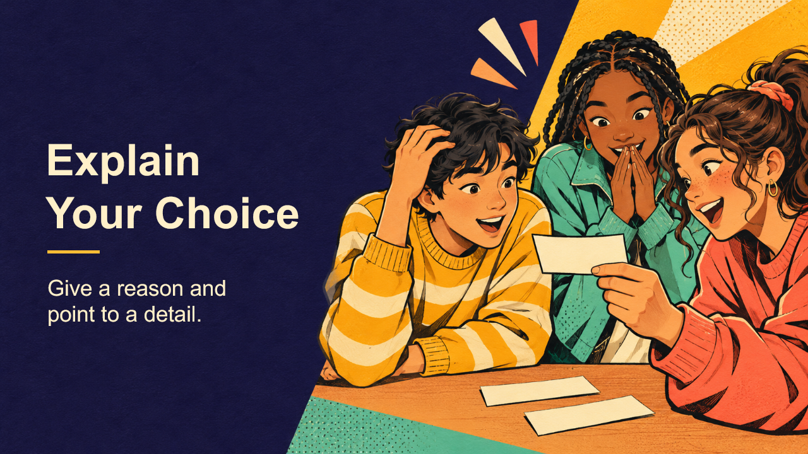
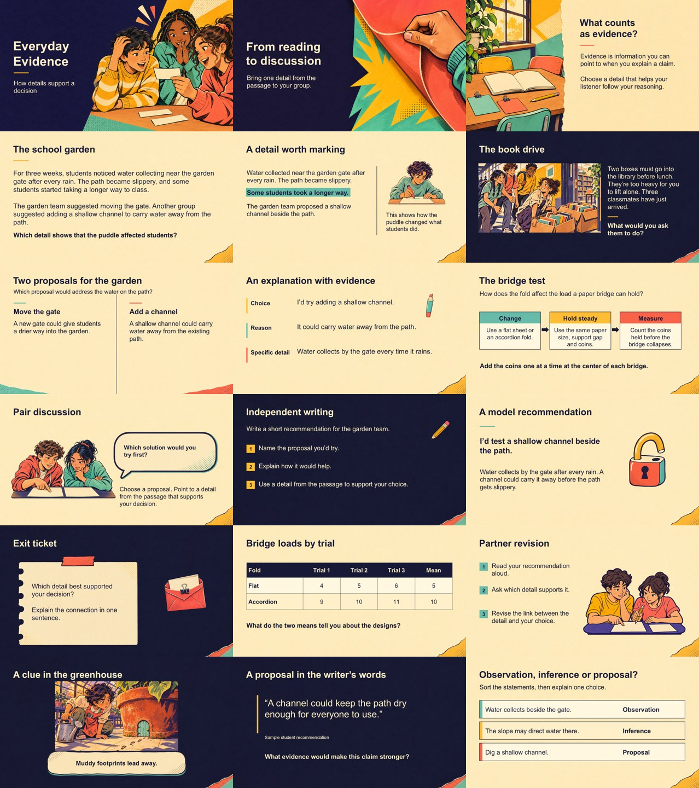

# School Zine PPTs



An AI skill for making editable teaching PowerPoints in the **School Zine PPTs** style: ink-indigo and cream surfaces, marigold, coral and mint accents, hand-painted *Finish the Line* illustrations and readable text boxes. It bundles 18 copyable teaching layouts, a reference lesson and 140 images, and it works for any subject or level.



## Install

**Download:** [artifact-template-school-zine-ppts.zip](https://github.com/leckwallnut/school-zine-ppts/releases/latest/download/artifact-template-school-zine-ppts.zip) from the [latest release](https://github.com/leckwallnut/school-zine-ppts/releases/latest). Unzip it. You get one folder, `artifact-template-school-zine-ppts`, with `SKILL.md` at its root.

Copy that whole folder into your assistant's personal skills folder, keeping its name and everything inside it:

| Assistant | Personal skills folder |
| --- | --- |
| Codex | `~/.codex/skills/` (on Windows, `C:\Users\<your-name>\.codex\skills\`) |
| Claude Code | `~/.claude/skills/` (on Windows, `C:\Users\<your-name>\.claude\skills\`) |
| Other assistants that support [Agent Skills](https://agentskills.io) | See that assistant's documentation for its skills folder |

Afterwards `SKILL.md` must sit directly inside `artifact-template-school-zine-ppts`. Start a new chat or restart the assistant, then ask: "Which skills can you use?" The list should include `artifact-template-school-zine-ppts`.

You can also ask your assistant to install it for you:

```text
Please install the School Zine PPTs skill from https://github.com/leckwallnut/school-zine-ppts

The skill is the folder artifact-template-school-zine-ppts in that repository. Copy that whole folder, keeping its name and everything inside it, into your personal skills folder so I can use it in every project. Do not change any files. Then tell me where you put it, and check that you can see a skill named artifact-template-school-zine-ppts.
```

## Use it

In Codex, name the skill with `$`:

```text
Use $artifact-template-school-zine-ppts to create a 10-slide presentation for upper-intermediate English learners on giving reasons and pointing to details. The lesson is 50 minutes. Use a mix of reading, pair discussion and a short writing task. Choose varied layouts and images, keep all text editable, check every slide, and give me the PPTX.
```

In other assistants, ask in ordinary words ("Use the School Zine PPTs skill to ...") or paste `Read ./artifact-template-school-zine-ppts/SKILL.md and use that skill for this task.` before your request.

## What is inside

| Resource | Where |
| --- | --- |
| The skill | [SKILL.md](artifact-template-school-zine-ppts/SKILL.md) |
| 18 editable layouts | [layout-library.pptx](artifact-template-school-zine-ppts/assets/layout-library.pptx) and the [numbered guide](artifact-template-school-zine-ppts/references/layouts.md) |
| 10-slide reference lesson | [reference.pptx](artifact-template-school-zine-ppts/assets/reference.pptx) |
| 140 images and their catalog | [asset-catalog.json](artifact-template-school-zine-ppts/assets/art/asset-catalog.json) and the [image guide](artifact-template-school-zine-ppts/references/image-library.md) |
| Design rules | [design-system.md](artifact-template-school-zine-ppts/references/design-system.md) |
| What was compressed | [distribution-notes.md](artifact-template-school-zine-ppts/references/distribution-notes.md) |

## Good to know

- This is a compressed copy sized for slides. Opaque pictures are JPEG and transparent pictures stay PNG; the catalog records each picture's size and checksum.
- The artwork is AI-generated illustration, not documentary evidence. Cite real sources separately when a lesson needs evidence.
- The slides use Arial. You need PowerPoint (or another editor) to open and adapt the decks, and an assistant that can write PowerPoint files to create new ones.

## License

[CC BY-NC 4.0](LICENSE): free to share and adapt with credit, not for commercial use. The license covers the skill's own slides, images and guides.
